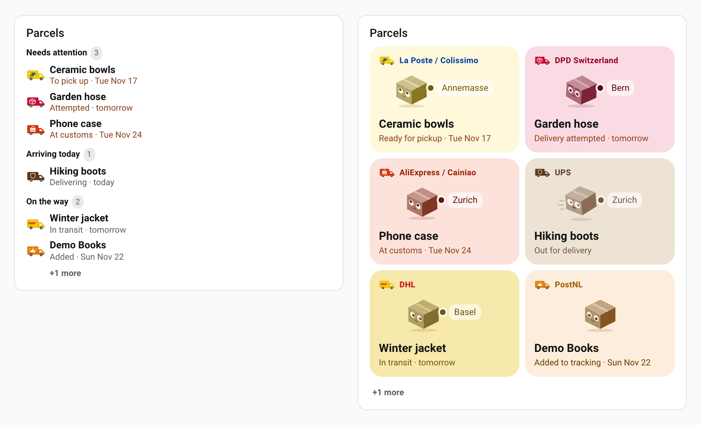

<div align="center">


# Peek for Home Assistant

**Every parcel you're waiting for, from every carrier, on your dashboard.**

Sensors, a calendar, an event for each change and a card, from your [Peek](https://peektracker.com) list.

[](https://hacs.xyz/docs/faq/custom_repositories)
[](https://github.com/plhery/peek-ha/releases)
[](https://github.com/plhery/peek-ha/actions/workflows/hassfest.yml)
[](https://github.com/plhery/peek-ha/actions/workflows/tests.yml)

[Install](#install) · [The card](#the-card) · [Entities](#entities) · [Actions](#actions) · [Automations](docs/automations.md) · [Privacy](docs/privacy.md)

<picture>
  <source media="(prefers-color-scheme: dark)" srcset="images/hero-dark.webp">
  
</picture>

</div>

## What you get

- **A card** that looks like Peek's widgets, as a list or as cards with Pip, in your theme and language.
- **Sensors** for the parcels on their way, arriving today, needing you, delivered today, and the next delivery day.
- **A Deliveries calendar**, with each parcel on its expected day.
- **An event for each change**: a parcel added, moving on, out for delivery, needing you or delivered.
- **Actions** to add parcels from any text (an order email, say), archive one, or read the list.
- **Assist** can answer "what arrives today?".

It needs Home Assistant 2026.10 or later and a Peek account.

## Install

[](https://my.home-assistant.io/redirect/marketplace_repository/?owner=plhery&repository=peek-ha&category=integration)

The button opens Peek in the Marketplace (Home Assistant 2026.11 and later) or in HACS. Download it, then restart Home Assistant if HACS asks you to.

<details>
<summary>Without the button</summary>

- **Marketplace** (2026.11 and later): **Settings › Marketplace › Add from link**, enter `https://github.com/plhery/peek-ha`. The first time, it asks you to connect GitHub.
- **HACS**: add `https://github.com/plhery/peek-ha` as a custom repository of the **Integration** type, download Peek and restart.
- **By hand**: copy `custom_components/peek` into your configuration's `custom_components` folder and restart.

</details>

## Set up

[](https://my.home-assistant.io/redirect/config_flow_start/?domain=peek)

1. Select the button, or go to **Settings › Devices & services › Add integration** and choose **Peek**.
2. Your browser opens Peek. Sign in, check what Home Assistant asks for and select **Allow**.
3. [My Home Assistant](https://my.home-assistant.io) brings you back. The first time, it asks for your Home Assistant's address.

There is no client id or secret to type. One Peek account can be connected to each Home Assistant.

## The card

The integration loads its card on every dashboard; there is no resource to add. Edit a dashboard, select **Add card**, then the **By card** tab, search for "Peek" and pick **Peek parcels**. Or in YAML:

```yaml
type: custom:peek-parcels-card
style: cards
show_delivered: true
title: Parcels
```

| Option | Default | |
| --- | --- | --- |
| `entity` | `sensor.peek_on_the_way` | The parcels to show. |
| `style` | `list` | `list`: a row per parcel with its carrier's truck. `cards`: a card per parcel in its carrier's colours, with Pip, a section's full width. |
| `show_delivered` | `false` | Adds today's deliveries after the parcels on their way. |
| `delivered_entity` | `sensor.peek_delivered_today` | Where today's deliveries come from. |
| `max_rows` | `6` | Parcels shown before "+N more", 1 to 30. |
| `title` | none | A title above the parcels. |

Parcels come in the order of Peek's sections: needs attention, arriving today, on the way. The card follows your theme, light or dark, and your language (English or French). Set `--peek-attention-color` in a theme to change the colour of parcels that need you.

## Entities

| Entity | State | `parcels` attribute |
| --- | --- | --- |
| `sensor.peek_on_the_way` | Parcels on their way | All of them (50 at most), each with its `section`: `attention`, `today` or `active` |
| `sensor.peek_arriving_today` | Out for delivery or expected today | |
| `sensor.peek_needs_attention` | At a pickup point, missed, at customs | |
| `sensor.peek_delivered_today` | Delivered today, not archived | Those parcels |
| `sensor.peek_next_delivery` | The next day a parcel is expected | The parcels expected that day |
| `calendar.peek_deliveries` | All-day events: a parcel on its expected day, a delivery on its day | |
| `event.peek_parcel_updates` | One event per change, below | |

Entity ids follow your language; these are the English ones. "Today" is the day in Home Assistant's time zone. Peek is read every 30 minutes, every 10 on a day a parcel is expected, and right after an action. `homeassistant.update_entity` on any Peek entity reads it now.

### Parcel updates

| Event type | When |
| --- | --- |
| `added` | A parcel appears in Peek. |
| `status_changed` | Its stage changes. |
| `out_for_delivery` | It goes out for delivery. |
| `needs_attention` | It needs you: pickup, missed delivery, customs. |
| `delivered` | It is delivered. |
| `expected_delivery_changed` | Its expected day moves. |

Each event carries the parcel's `id`, `name`, `carrier`, `status`, `status_text`, `needs_attention`, `expected_delivery` and `location`. The first read after Home Assistant starts fires nothing. See [automation examples](docs/automations.md).

## Actions

| Action | What it does |
| --- | --- |
| `peek.add_parcels` | Finds the tracking numbers in a `text` and adds each one, with an optional `name`. Returns each number's outcome. |
| `peek.archive_parcel` | Archives a `parcel`, by id or tracking number. You can restore it in Peek. |
| `peek.get_parcels` | Returns the parcels that match a `status`, `sort`, `search` and `limit`. |

Fields, responses and examples: [docs/actions.md](docs/actions.md).

## Assist

Once a Peek entity is exposed to Assist, Assist can list your parcels to answer "what arrives today?" or "where's my parcel from Fjord Outdoor?". It can't add or archive them. What it reads goes to the conversation agent you chose.

## Troubleshooting

| You see | Do this |
| --- | --- |
| **Peek parcels** isn't in **Add card** | Reload the page. In the Home Assistant app, close the app and open it again. |
| "Authentication expired for Peek" | Peek refused the connection, often because Home Assistant was disconnected in Peek. Select **Reconfigure** and sign in again. |
| "This connection may not do this" | Reconfigure and allow Home Assistant to see and add parcels. |
| "Too many requests to Peek" | Wait a minute and try again. |
| Peek says it can't connect assistants to your account | Peek's connections for assistants are in beta and not open to every account yet. |

When you open an issue, attach the integration's diagnostics (**Settings › Devices & services › Peek › ⋮ › Download diagnostics**). They leave out the tokens and every parcel's name, number, shop and place.

## Privacy

Home Assistant talks only to `peektracker.com`. The card draws from Home Assistant's states and loads nothing else. To remove Peek, delete it in **Settings › Devices & services**, or select **Disconnect** next to Home Assistant in Peek's **Settings › Assistants**; your parcels stay in Peek. More in [docs/privacy.md](docs/privacy.md).

## Development

See [docs/development.md](docs/development.md). Tests use synthetic parcels and mocked HTTP only.

## License

[Apache License 2.0](LICENSE)
